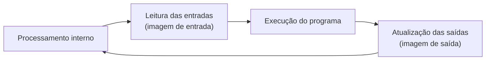

# Ciclo de varredura (scan)

## O que é e quando usar

O CLP não observa as entradas o tempo todo nem reage a elas de forma instantânea: as entradas são amostradas periodicamente (BOLTON, 2015). Ele repete, sem parar, uma sequência fixa de operações chamada **ciclo de varredura** (*scan*). Entender essa sequência explica por que um pulso curto pode ser perdido, por que a ordem das linhas do programa importa e por que escrever duas vezes na mesma saída não produz o efeito esperado.

Esse conhecimento vale para qualquer linguagem e qualquer fabricante, e deve vir antes de qualquer programa.

## Como funciona

No modo RUN, o CLP repete quatro operações (HANSSEN, 2015):



1. **Processamento interno:** o CLP verifica o próprio estado, atualiza relógios, trata mudanças de modo e reinicia o temporizador de vigilância (*watchdog*).
2. **Leitura das entradas:** o estado dos módulos de entrada é copiado para a memória.
3. **Execução do programa:** as instruções são executadas em sequência, e os valores de saída são atualizados na memória.
4. **Atualização das saídas:** a memória de saída é copiada para os módulos. Somente nesse momento as saídas físicas mudam.

Copiar todas as entradas de uma vez, em vez de lê-las no ponto em que são usadas, evita que o mesmo endereço mude de valor no meio da execução. O custo é que pulsos mais curtos que o ciclo podem passar despercebidos (HANSSEN, 2015).

O **tempo de ciclo** depende da CPU, do tamanho do programa, do número de entradas e saídas lidas e das funções de sistema em uso. Quanto mais complexo o programa, maior o ciclo (BOLTON, 2015).

### Consequências práticas

- **Pulso mínimo:** uma entrada precisa durar mais que o tempo de ciclo para ser vista com segurança (BOLTON, 2015). Exemplo numérico ilustrativo: com ciclo de 20 ms, um pulso de 5 ms pode ocorrer entre duas leituras e nunca chegar ao programa.
- **Atraso de resposta:** por dedução da sequência acima, se a entrada muda logo depois da leitura, ela só é lida no ciclo seguinte e só atua na saída ao fim desse ciclo. No pior caso, a resposta leva cerca de dois ciclos, sem contar filtros e atrasos dos módulos.
- **Saída só muda no fim:** as saídas físicas só mudam na última operação do ciclo (HANSSEN, 2015). O mesmo vale para o Ladder do WLP da WEG, que grava a imagem das saídas nas saídas físicas em uma única operação ao final do ciclo (WEG, 2016).
- **Última escrita vence:** durante a execução, os valores das saídas são alterados na memória e só o resultado final é gravado nas saídas físicas (WEG, 2016). Se o programa escreve várias vezes na mesma saída em um ciclo, apenas o último valor chega ao módulo.

### Formas de execução

Em sistemas baseados na IEC 61131-3, o programa é associado a uma **tarefa**, que define quando ele roda. Os três modos mais comuns são (HANSSEN, 2015):

| Modo | Como funciona | Quando usar |
|------|---------------|-------------|
| Cíclica | Novo ciclo a intervalos fixos. O intervalo deve ser maior que o tempo de execução. | Contagem de tempo e controle PID |
| Livre (*freewheeling*) | Novo ciclo começa assim que o anterior termina. O tempo varia. | Execução mais rápida possível |
| Por evento | Executa só quando uma condição booleana é verdadeira. | Parada de emergência e rotinas de partida |

Tarefas também têm prioridade: as de prioridade mais alta são atendidas antes e costumam conter funções críticas, como emergência e alarmes (HANSSEN, 2015).

## Exemplo aplicado

Contagem de peças em uma esteira, em ST (texto estruturado), no CODESYS. A palavra-chave `AT` associa a variável a um endereço de entrada ou saída (HANSSEN, 2015).

```pascal
PROGRAM Contador
VAR
    sensor_peca AT %IX0.0 : BOOL;   // entrada: sensor na esteira
    borda_peca  : R_TRIG;           // detector de borda de subida
    pecas       : UINT;             // total de peças contadas
END_VAR

borda_peca(CLK := sensor_peca);

IF borda_peca.Q THEN                // TRUE por um único ciclo
    pecas := pecas + 1;
END_IF
```

Pela norma, a saída `Q` de um `R_TRIG` fica em 1 de uma execução do bloco até a seguinte, após a transição de 0 para 1 da entrada `CLK`, e volta a 0 na execução seguinte (INTERNATIONAL ELECTROTECHNICAL COMMISSION, 2003). Sem a detecção de borda, o contador aumentaria a cada ciclo enquanto a peça cobrisse o sensor.

### Armadilha: escrita dupla na mesma saída

```pascal
// no início do programa
lampada := alarme_nivel;

// ... mais adiante, em outro ponto
lampada := modo_manual;     // sobrescreve o valor anterior
```

Só o último valor, o de `modo_manual`, chega ao módulo de saída, e o primeiro é perdido. Jack (2008) descreve esse como um erro comum de iniciantes em Ladder: repetir a mesma saída invalida a primeira ocorrência, e a primeira linha nunca terá efeito. A solução é escrever cada saída em um só lugar, combinando as condições:

```pascal
lampada := alarme_nivel OR modo_manual;
```

## Diferenças entre fabricantes

| Plataforma | Como o programa é executado | Observação |
|------------|-----------------------------|------------|
| CODESYS | Tarefas cíclica, livre ou por evento (HANSSEN, 2015), com *watchdog* definido por tarefa (3S-SMART SOFTWARE SOLUTIONS, 2007). | Programas diferentes podem ter ciclos diferentes. |
| Schneider Modicon M241 | Tarefas cíclica, livre, por evento e por evento externo. Os POUs de uma tarefa são executados na ordem em que aparecem na lista (SCHNEIDER ELECTRIC, 2018). | O *watchdog* tem dois parâmetros: tempo e sensibilidade, esta definindo quantas expirações são toleradas antes de o controlador parar o programa (SCHNEIDER ELECTRIC, 2018). |
| Siemens S7-1200/1500 | O sistema operacional atualiza a imagem de processo e chama o programa de usuário (SIEMENS, 2018). | Se o tempo de monitoração de ciclo estoura uma vez, o S7-1200 segue em RUN e o S7-1500 vai para STOP quando o OB80 não está configurado (SIEMENS, 2018). OBs de interrupção cíclica vêm com ciclo padrão de 100 ms (SIEMENS, 2021). |
| Rockwell Logix 5000 (Studio 5000) | Tarefas contínua, periódica e por evento. A *MainTask* nasce contínua e tem a menor prioridade. Os programas de uma tarefa executam na ordem em que aparecem no organizador do controlador (ROCKWELL AUTOMATION, [s. d.]). | Em tarefa periódica, o período vai de 1 ms a 2.000 s (padrão de 10 ms) e deve ser maior que a soma dos tempos de execução dos programas. Cada tarefa tem *watchdog* próprio, com padrão de 500 ms (ROCKWELL AUTOMATION, [s. d.]). |
| Rockwell PLC-5 | Usa tabelas de imagem de entrada e de saída (por exemplo, `O:013/01`) e executa o programa em varreduras (ROCKWELL AUTOMATION, 1998). | |
| WEG WLP (Ladder) | As linhas são executadas em ordem fixa, a partir da primeira (WEG, 2016). | A bobina imediata grava a saída no momento da execução, ao contrário da bobina normal, que grava só no fim do ciclo (WEG, 2016). |

## Atualizações e comparação com versões mais recentes

Cada fonte citada acima foi comparada com a versão mais recente que encontrei (consulta em 21 nov. 2026). Onde não consegui abrir o documento novo, isso está dito.

| Fonte citada | Versão mais recente encontrada | Mudança relevante ou observação |
|--------------|--------------------------------|---------------------------------|
| IEC 61131-3, 2ª ed. (2003) | 3ª ed., de 20 fev. 2013 (INTERNATIONAL ELECTROTECHNICAL COMMISSION, 2013), e 4ª ed., de 22 maio 2025 (INTERNATIONAL ELECTROTECHNICAL COMMISSION, 2025). | A 3ª edição cancela e substitui a de 2003 e é uma extensão compatível dela (AMERICAN NATIONAL STANDARDS INSTITUTE - ANSI, [s. d.]). A 4ª edição inclui cadeias UTF-8 e lista, no Anexo B, os recursos adicionados, removidos ou obsoletos em relação à de 2013 (INTERNATIONAL ELECTROTECHNICAL COMMISSION, 2025). Não consegui conferir se a definição do `R_TRIG` mudou, porque o texto da norma é pago. |
| Siemens, Programming Guideline V1.6 (12/2018) | Não encontrei versão posterior do guideline. | Os valores de monitoração de ciclo vêm dessa versão. Confira na ajuda do TIA Portal em uso. |
| Schneider, Programming Guide EIO0000001432.07 (03/2018) | EIO0000003059, versão 10, de 1 abr. 2026 (SCHNEIDER ELECTRIC, 2026). | Não abri o PDF da versão 10. Na ajuda online do Machine Expert, a sensibilidade do *watchdog* é definida como o número de exceções que precisam ocorrer antes de o controlador detectar um erro de aplicação (SCHNEIDER ELECTRIC, [s. d.]a), redação diferente da usada em 2018. Os eventos externos associáveis a uma tarefa, conforme o controlador, são borda de subida em entrada avançada, limiares do HSC, parada do HSC e sincronismo CAN (SCHNEIDER ELECTRIC, [s. d.]b). |
| Rockwell, ajuda do Studio 5000, versão 37.00 | Versão 38.00, lançada em set. 2025 (ROCKWELL AUTOMATION, 2025). | A página "Tasks" da versão 38.00 traz os mesmos valores citados: período de 1 ms a 2.000 s com padrão de 10 ms, *watchdog* padrão de 500 ms e programas executados na ordem do organizador do controlador (ROCKWELL AUTOMATION, [s. d.]). |
| CODESYS: manual 2.3 (2007) e Hanssen (2015) | Ajuda online do CODESYS V3.5.22.0 (CODESYS GROUP, [s. d.]). | Além de cíclica, livre e por evento, existe tarefa disparada por status (CODESYS GROUP, [s. d.]). Em uma ajuda baseada no CODESYS V3 hospedada pela ABB, todas as tarefas compartilham uma única imagem de processo, consistente para apenas uma tarefa, e a aplicação deve copiar entradas e saídas para um local seguro em caso de conflito (ABB, [s. d.]). |
| WEG, WLP V10.00 (06/2016) | Não encontrei manual do WLP posterior à V10.00. | Nenhuma mudança verificada (WEG, 2016). |
| PLCopen, Coding Guidelines v1.0 (20 abr. 2016) | Não encontrei versão posterior. | Nenhuma mudança verificada (PLCOPEN, 2016). |
| Jack, versão 5.1 (2008) | Versão 6.0: a página de venda da edição antiga a descreve como substituída pela 6.0 (JACK, [s. d.]). | Não consegui abrir a versão 6.0. A afirmação sobre saída repetida em Ladder vem da versão 5.1 e precisa ser conferida na nova. |

## Erros comuns

- Esperar que a saída mude na própria linha em que foi atribuída.
- Ligar sinais muito rápidos a entradas comuns. Para esses casos existem módulos especiais (BOLTON, 2015).
- Escrever programas com laços que demoram a terminar. O *watchdog* existe justamente para detectar um programa que não sai de um laço, e quando ele expira o CLP entra em estado de erro (HANSSEN, 2015).
- Escrever a mesma saída em vários pontos do programa (JACK, 2008).
- Escrever uma mesma variável em mais de uma tarefa. A diretriz CP10 da PLCopen manda que cada variável seja escrita em uma única tarefa, porque a escrita concorrente leva a comportamento não determinístico (PLCOPEN, 2016).
- Usar tarefa livre para PID e temporização. Esses casos pedem tarefa cíclica, de ciclo fixo (HANSSEN, 2015).

## Exercícios

1. Um CLP tem ciclo de 30 ms. Qual é a frequência máxima de pulsos que ele consegue detectar, no melhor caso?

    ??? note "Resposta"
        Um pulso por ciclo, no máximo: 1 / 0,03 s ≈ 33 Hz. É o mesmo raciocínio do exemplo de Bolton (2015). Na prática, o pulso também precisa durar mais que o ciclo.

2. Com o mesmo ciclo de 30 ms, qual é o atraso máximo aproximado entre a mudança de uma entrada e a atuação da saída correspondente?

    ??? note "Resposta"
        Pela dedução apresentada acima, cerca de dois ciclos, ou seja, 60 ms, sem contar filtros de entrada e atrasos dos módulos.

3. No CODESYS, crie o programa `Contador`, simule o sensor com uma variável e altere o intervalo da tarefa cíclica. Observe o que acontece com pulsos mais curtos que o intervalo.

!!! note "Status de validação"
    Testado em: não testado. Os exemplos aguardam validação no CODESYS.

Fontes: ver [Referências](../99-referencias/index.md).
